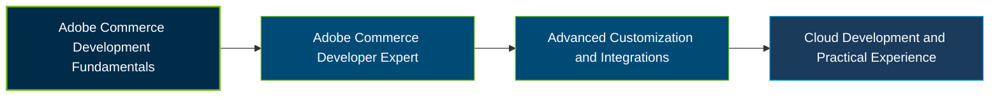

# Adobe Commerce Developer Expert Certification Exam Guide

A dedicated, comprehensive study guide and technical reference repository for developers preparing for the **Adobe Commerce Developer Expert Certification Exam (AD0-E725)**.

---

## Exam Overview

The Adobe Commerce Developer Expert certification validates advanced development knowledge and practical skills in building, customizing, integrating, and deploying Adobe Commerce solutions.

- **Exam Format**: Online proctored certification exam.
- **Target Audience**: Adobe Commerce backend developers, full-stack developers, and technical leaders.
- **Prerequisites**: No formal prerequisite is specified; Adobe recommends at least two years of hands-on Adobe Commerce experience, strong programming skills, and some App Builder experience.

---

## Core Exam Domains & Knowledge Areas

### 1. Architecture

- Adobe Commerce caching, plugins, preferences, observers, and multi-site configuration.
- Composer modifications, Git patches, security features, CRON scheduling, and indexing.
- Application architecture, performance considerations, and development standards.

### 2. External Integrations

- Customizing data flows between Adobe Commerce and SaaS services.
- Using Adobe App Builder for extensible application integrations.
- Implementing Adobe I/O events and webhooks.

### 3. Customizations

- Customizing product catalogs, checkout, sales operations, and the admin panel.
- Programmatic entity manipulation and Adobe Commerce API customization.
- Working with message queues and writing integration tests.

### 4. Cloud

- Adobe Commerce Cloud architecture and environment configuration.
- Setting up and configuring Adobe Commerce Cloud projects.
- Using the Adobe Commerce Cloud CLI for development and deployment workflows.

---

## Certification Path

*Suggested learning progression; this diagram does not represent an official Adobe certification prerequisite or successor pathway.*

---

## Recommended Practice & Study Resources

To prepare effectively, combine Adobe's official learning materials with practical Adobe Commerce development experience and focused exam practice:

- **CertsGate**: Explore [Adobe AD0-E725 preparation resources](https://certsgate.com/exams/adobe/ad0-e725) for supplementary practice questions and exam preparation.
- **Adobe Commerce Developer Documentation**: Study the [Adobe Commerce developer documentation](https://developer.adobe.com/commerce/) and practice architecture, customization, integrations, and cloud development concepts.
